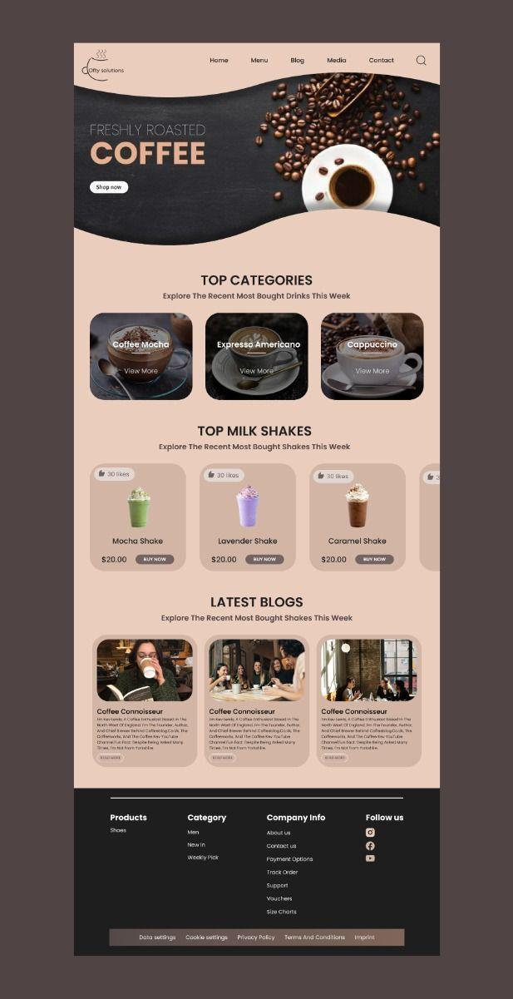

# Cofty Solutions

Cofty Solutions is a coffee storefront prototype built for UI/UX Challenge 5. I chose the challenge to practice building a responsive React frontend and explore how coffee lovers could find drinks and café stories in one place.

## Design reference



The page follows the reference's peach palette, wave-shaped coffee hero, category cards, milkshake cards, blog cards, and dark footer. It uses React, TypeScript, Vite, CSS Modules, and Bootstrap Icons.

## Run locally

Use Node.js 22.12 or later. From the folder containing `package.json`:

```sh
npm ci
npm run dev
```

Open the local address Vite prints in the terminal.

```sh
npm run lint
npx tsc --noEmit -p tsconfig.app.json
npm run build
```

## Navigate the prototype

- **Home** returns to the hero.
- **Menu** and **Shop now** jump to the coffee categories, followed by the milkshakes.
- **Blog** jumps to the Latest Blogs heading. **Media** jumps directly to the photo cards in that section.
- **Contact** jumps to the company information in the footer.
- On narrow screens, open the hamburger menu to access the same links. The menu closes after you choose a destination.

Search, likes, purchasing, and article buttons are visual placeholders in the prototype.

## Deployment and author

- [Vercel preview](https://ui-challenge-5.vercel.app/)
- [Omphile Lucas on GitHub](https://github.com/Omphile-coder)
